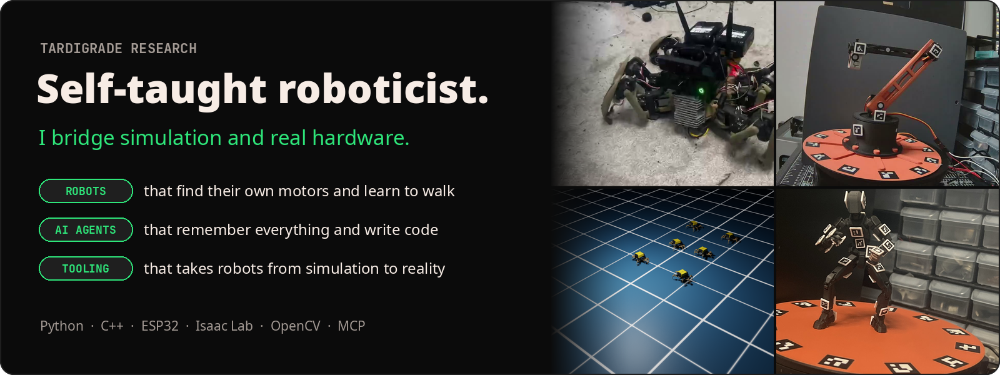
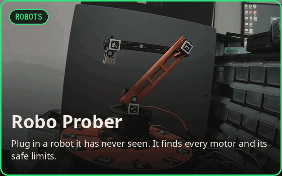
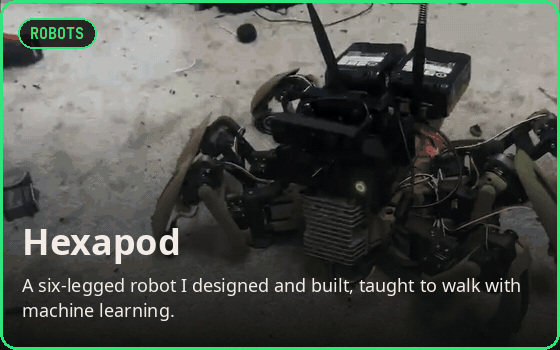
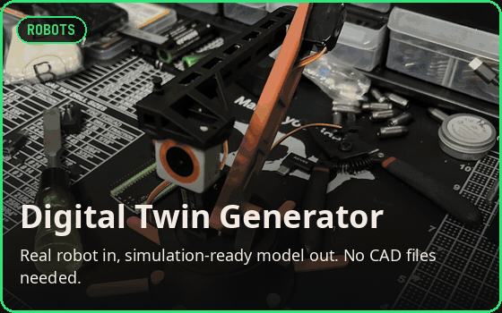
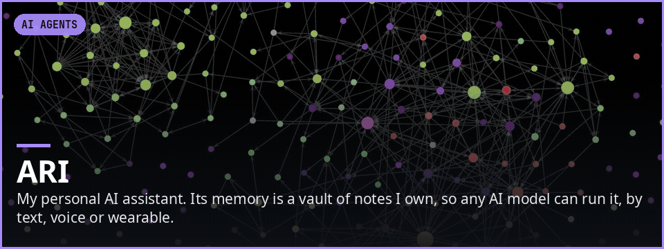
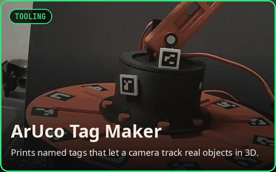
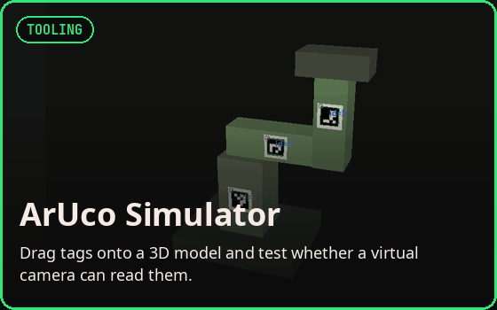
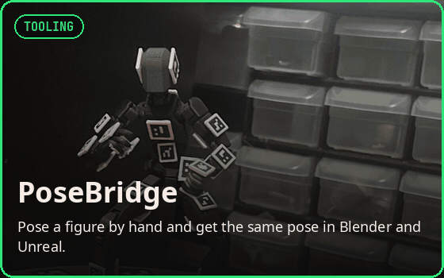
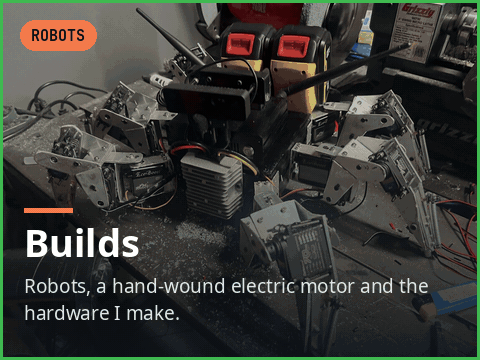

<b>Every tile is a project. Click one to open it.</b> 
<a href="mailto:tardigraderesearch@yahoo.com">tardigraderesearch@yahoo.com</a>

### Robots and AI

&nbsp;
&nbsp;

### Tooling and builds

&nbsp;
&nbsp;

### How I work

I start from the physical problem and the person who has to use the tool, then design
the system around it: what it must do, what "working" means, and what must never happen.

- **Safety before convenience.** Hardware doesn't move until it's armed, stays inside
  limits a person set, moves at a capped speed, and can always be stopped.
- **It has to just work.** One launcher checks its own dependencies, builds its own
  environment and runs on Linux, Windows and macOS.
- **Pieces that compose.** I break big systems into tools that stand on their own and
  plug into each other.
