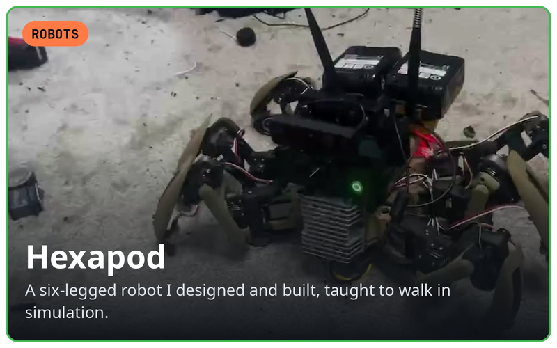
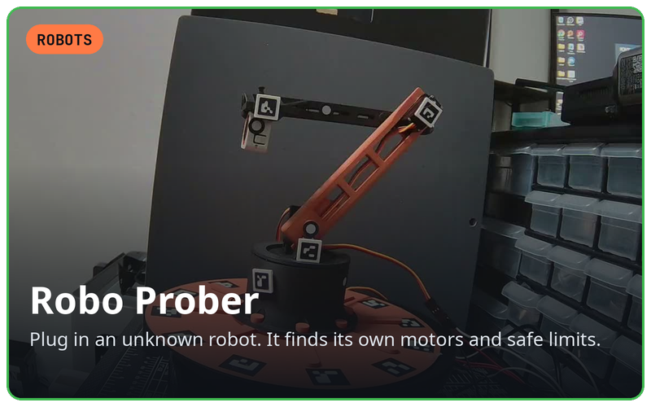
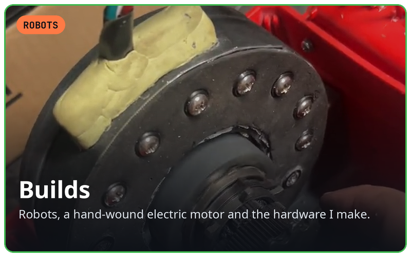
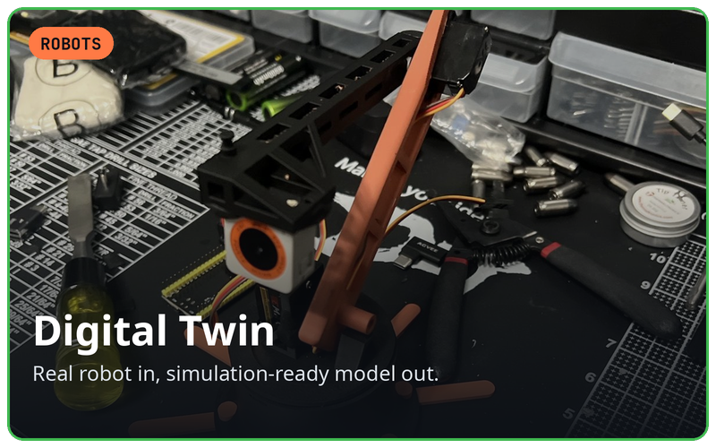
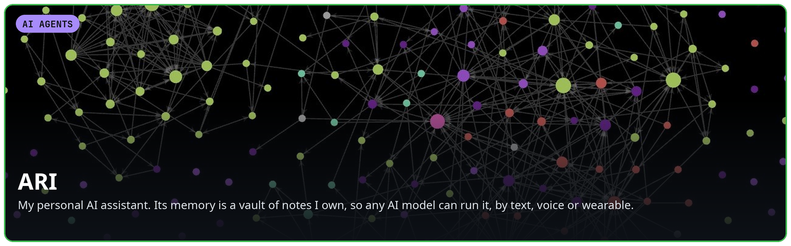
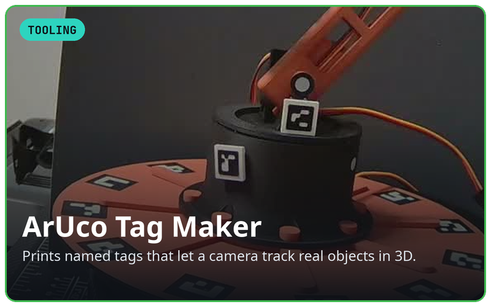
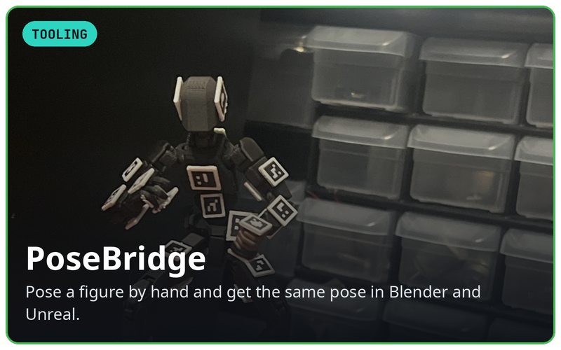
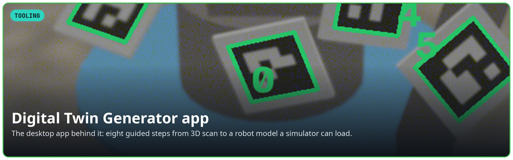

<b>Click any tile to open the project.</b> 
<a href="mailto:tardigraderesearch@yahoo.com">tardigraderesearch@yahoo.com</a>

### Robots

### AI agents

### Tooling

### Currently

- **U.S. Air Force Independent Duty Medical Technician (Staff Sergeant).** A credentialed provider who has treated 6,000+ patients without an on-site physician, and an instructor for the rescue teams that cover astronauts and Navy SEALs.
- **Directing AI coding agents** (Claude, Codex, Gemini) in parallel against written specs and tests, through ARI, my own assistant. An acceptance gate grades every job on independent checks rather than the agent's own report: 255 jobs graded so far.
- **Proving robots safe before they move.** 0 of 220,902 commanded servo pulses left their safe limits across 26 randomized simulated robots, backed by 450+ automated tests and CI on Linux, Windows and macOS.

### How I work

I start from the physical problem and the person who has to use the tool, then design
the system around it: what it must do, what "working" means, and what must never happen.

- **Safety before convenience.** Hardware doesn't move until it's armed, stays inside
  limits a person set, moves at a capped speed, and can always be stopped.
- **It has to just work.** One launcher checks its own dependencies, builds its own
  environment and runs on Linux, Windows and macOS.
- **Pieces that compose.** I break big systems into tools that stand on their own and
  plug into each other.
