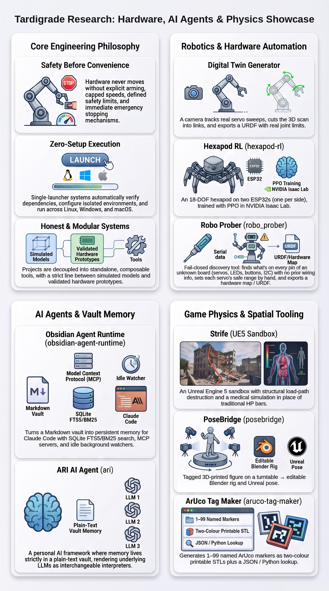

# I build things.

Game engines, AI agents, robots, and the tooling that holds them together.
I learn a stack by shipping something in it, and I measure before I claim.

### Currently

- **Digital Twin Generator** — built robot in, verified simulation-ready model out. A camera
  watches each servo wiggle and sweep its range, then the tool cuts the 3D scan into links and
  exports a URDF with real joint limits. Showcase: [digital-twin-generator](https://github.com/tardigraderesearch/digital-twin-generator).
- **Strife** — a UE5 sandbox where buildings fail along real load paths and
  injuries run on a medical simulation instead of HP bars. Source private;
  preview: [strife](strife/README.md).
- **PoseBridge** — pose a tagged, 3D-printed figure on a turntable and get an
  editable Blender rig and an Unreal pose. Showcase: [posebridge](https://github.com/tardigraderesearch/posebridge).
- **ARI** — a personal AI whose memory lives in a plain-text vault, so the model
  underneath is replaceable. Showcase: [ari](https://github.com/tardigraderesearch/ari).

### Open source

| Repo | What it does | Stack |
|---|---|---|
| [obsidian-agent-runtime](https://github.com/tardigraderesearch/obsidian-agent-runtime) | Persistent, searchable vault memory for Claude Code | Python, MCP, SQLite FTS5 |
| [hexapod-rl](https://github.com/tardigraderesearch/hexapod-rl) | 18-DOF hexapod trained in simulation | Isaac Lab, PPO, ESP32 |
| [robo_prober](https://github.com/tardigraderesearch/robo_prober) | Map an unknown servo robot; safe firmware and range-of-motion tool | Python, C++, ESP32 |
| [aruco-tag-maker](https://github.com/tardigraderesearch/aruco-tag-maker) | Named ArUco tags as printable STLs plus a lookup file | Python, OpenCV, tkinter |

### Hardware

Robots, motors and the physical side of things: [builds](https://github.com/tardigraderesearch/builds).

### How I work

I start from the physical problem and the person who has to use the tool, then design
the system around it: what it must do, what "working" means, and what must never happen.

- **Safety before convenience.** Hardware doesn't move until it's armed, stays inside
  limits a person set, moves at a capped speed, and can always be stopped.
- **It has to just work.** One launcher checks its own dependencies, builds its own
  environment and runs on Linux, Windows and macOS.
- **Pieces that compose.** I break big systems into tools that stand on their own and
  plug into each other.
- **Honest labels.** Simulation is called simulation, prototypes are called prototypes,
  and numbers carry dates.
- **Nothing ships unreviewed.** I mark up every draft before it goes public.

### Contact
tardigraderesearch@yahoo.com
