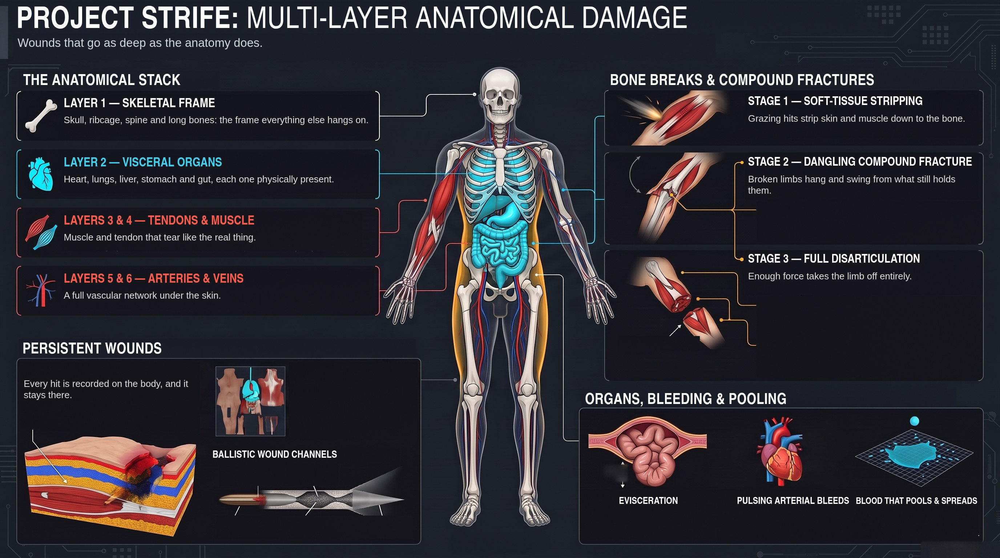
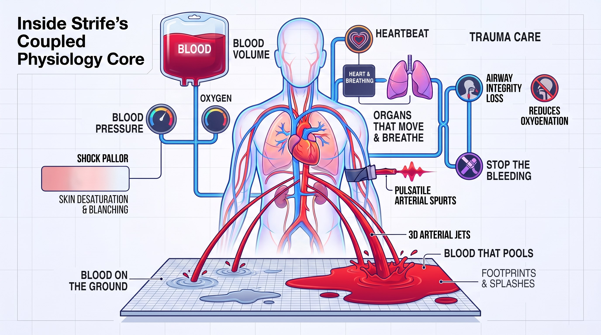
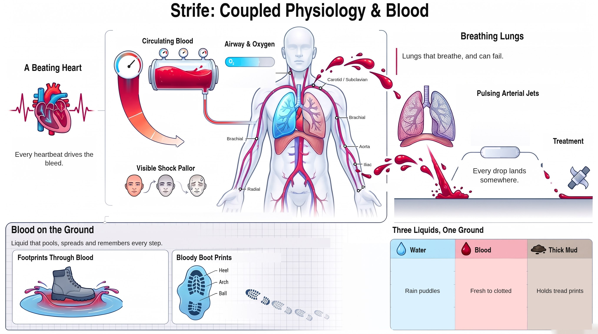
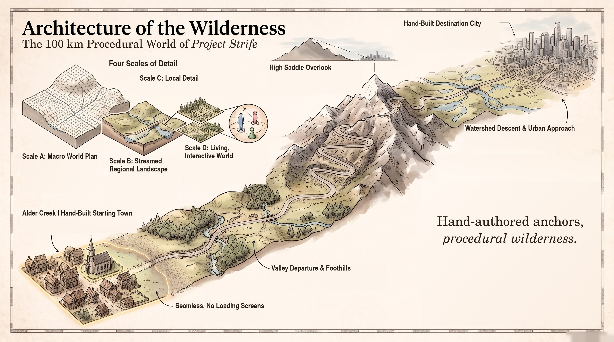
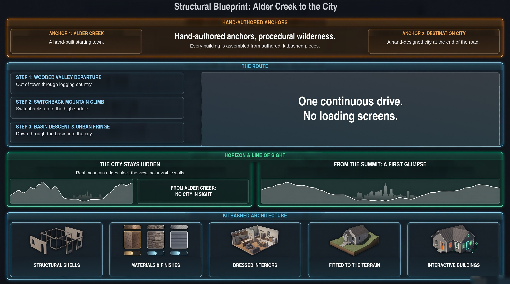

# Strife

A UE5 sandbox where buildings fail along real load paths and injuries run on a
medical simulation instead of HP bars. Source private; this page is a preview.

## Bodies that take damage like bodies

## A world that keeps going

[Back to profile](../README.md)
